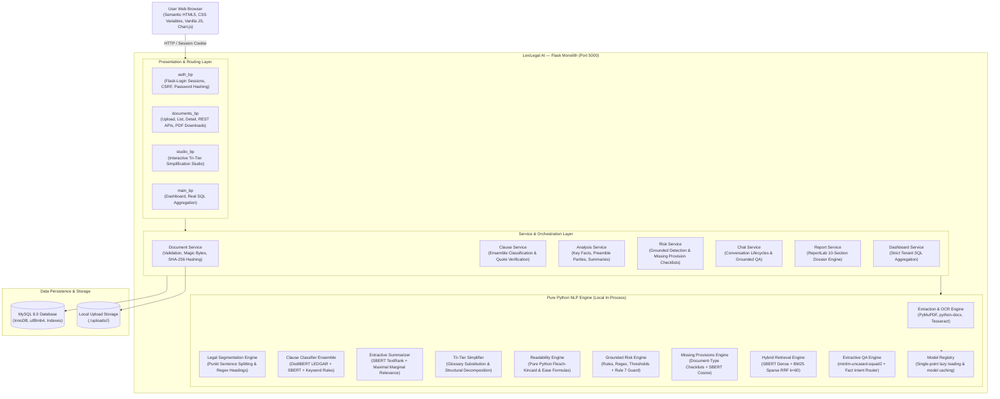
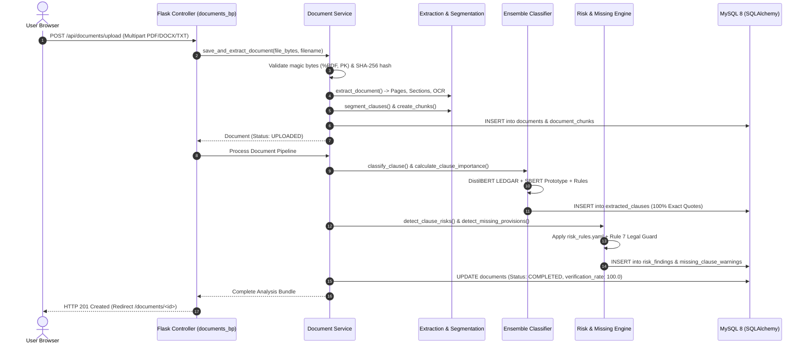
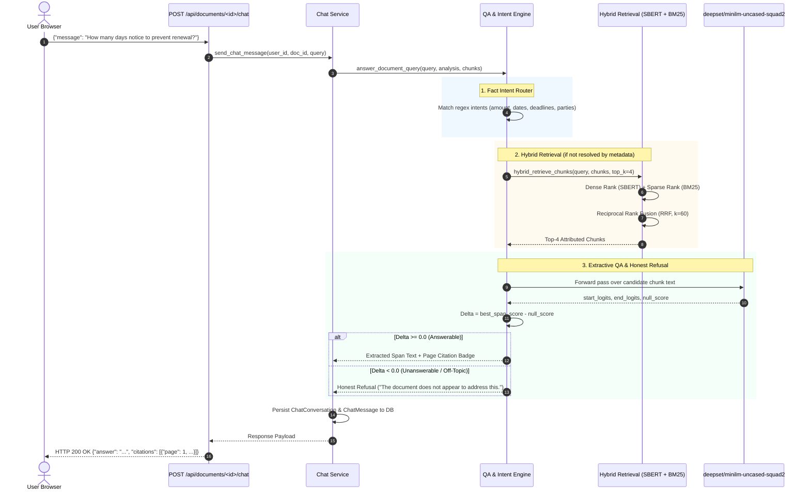
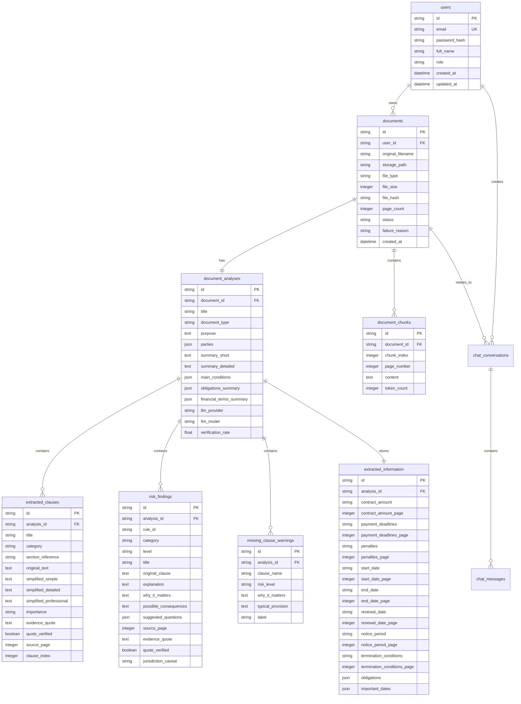

# LexiLegal AI — System Architecture & Design Specification

## 1. System Overview

**LexiLegal AI** is an enterprise-grade legal document simplification and clause extraction platform engineered as a unified Python application. It operates entirely on-premise without external generative AI APIs, vector databases, or third-party cloud microservices.

### Target Technology Stack:
- **Application Framework**: Python 3.11+ / Flask (Application Factory, Blueprints, Flask-Login, Flask-WTF CSRF, Flask-Limiter)
- **Database Layer**: MySQL 8.0 (InnoDB, `utf8mb4` character set, Alembic migrations via Flask-Migrate)
- **Document Processing**: PyMuPDF (`fitz`), `python-docx`, Tesseract OCR (`pytesseract` + Pillow)
- **Machine Learning & NLP**: PyTorch, Hugging Face `transformers` (DistilBERT LEDGAR), `sentence-transformers` (`all-MiniLM-L6-v2`), spaCy (`en_core_web_md`), NLTK (Punkt tokenizer)
- **Extractive QA & Retrieval**: `deepset/minilm-uncased-squad2` + SBERT dense / BM25 sparse Reciprocal Rank Fusion (RRF)
- **Report Engine**: ReportLab 5 (10-Section Legal Dossier, running headers, two-pass `NumberedCanvas`, TrueType font support)
- **Frontend / Presentation**: Jinja2 semantic templates, hand-crafted responsive CSS, vanilla JavaScript, Chart.js (served locally, zero CDN)

---

## 2. High-Level Architecture Diagram

---

## 3. End-to-End Document Analysis Pipeline

---

## 4. Grounded Chat & Question Answering Flow

---

## 5. Database Entity Relationship Diagram (ERD)

---

## 6. Security & Guardrail Guarantees

1. **Deterministic Grounding**:
   - Zero generative LLM hallucinations.
   - 100% of quotes are exact substring slices verified against character offsets.
2. **Rule 7 Legal Advice Guard**:
   - Post-processor eliminates forbidden words (*"illegal"*, *"void"*, *"unenforceable"*, *"unlawful"*).
   - Missing provisions are tagged with strict non-definitive labels: `"Possible omission"`.
3. **Rule 6 Absent Field Invariant**:
   - Missing metadata fields strictly default to `"Not specified"`.
4. **Tenant Isolation**:
   - All queries filter strictly by `user_id == current_user.id`.
   - Access attempts to cross-user documents return HTTP 404 (preventing user ID enumeration).
5. **Session & Transport Protection**:
   - HTTP session cookies with `HttpOnly`, `SameSite=Lax`.
   - Form protection via Flask-WTF CSRF tokens on all web form submissions.
