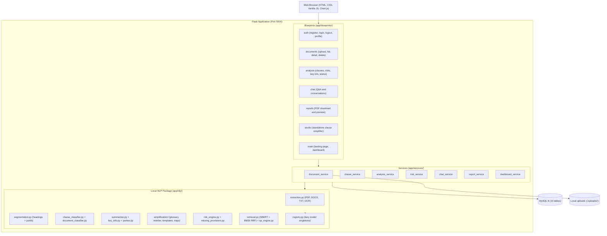
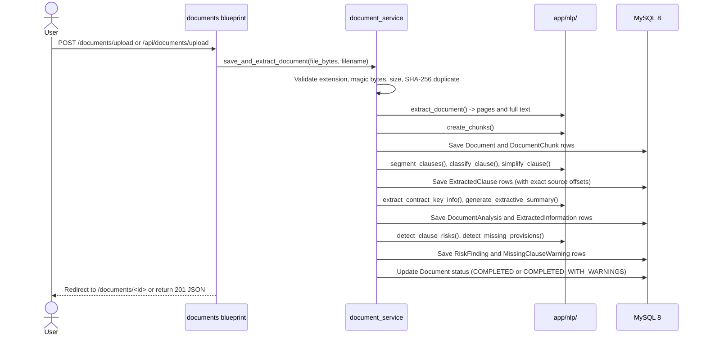
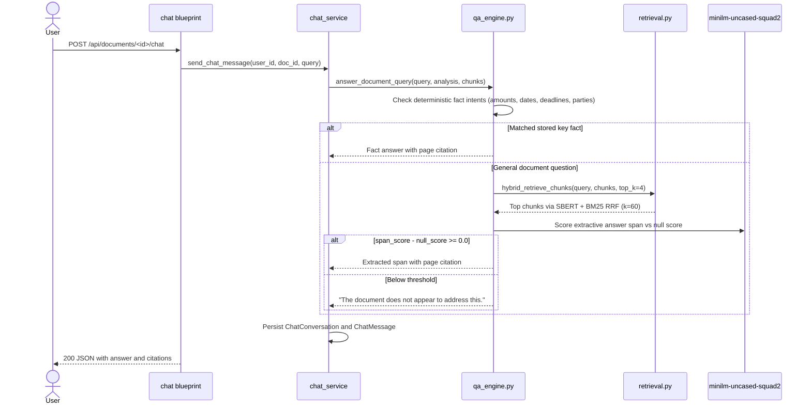
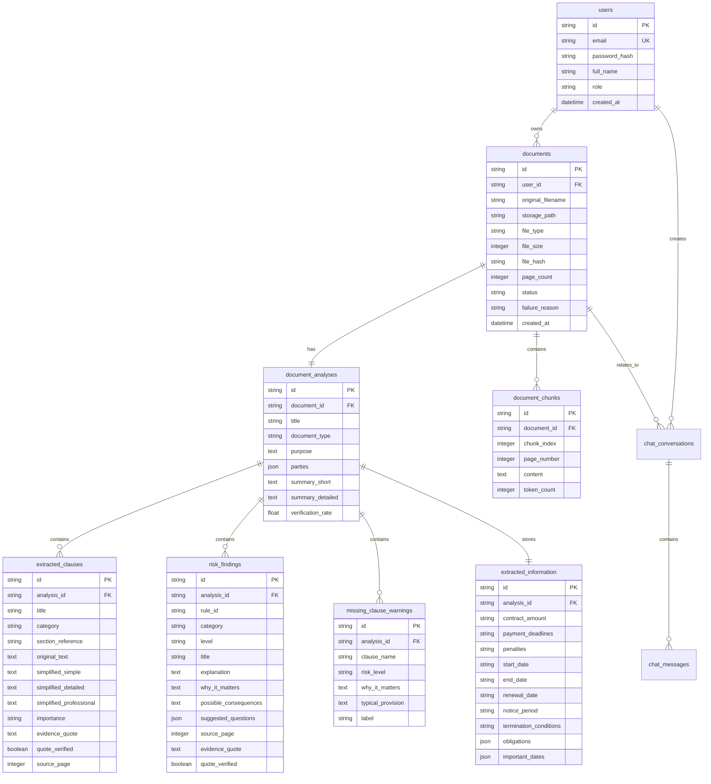

# System Architecture

KanoonSaathi is a single Flask application backed by MySQL 8 and a local Python NLP pipeline. All text extraction, classification, simplification, risk checks, and document Q&A run in-process without calling external AI services.

## Stack

- **Web server**: Python 3.11+, Flask (app factory, blueprints), Flask-Login, Flask-WTF (CSRF), Flask-Limiter
- **Database**: MySQL 8 (`InnoDB`, `utf8mb4`), SQLAlchemy, Alembic via Flask-Migrate
- **Extraction**: PyMuPDF (`fitz`), `python-docx`, Tesseract OCR (`pytesseract` + Pillow)
- **NLP and ML**: PyTorch, Hugging Face `transformers` (LEDGAR DistilBERT, `deepset/minilm-uncased-squad2`), `sentence-transformers` (`all-MiniLM-L6-v2`), spaCy (`en_core_web_md`), NLTK (`punkt`), scikit-learn
- **PDF reports**: ReportLab with local TrueType fonts (`LiberationSans`)
- **Frontend**: Jinja2 templates, hand-written CSS with local Liberation Serif fonts, vanilla JavaScript, local Chart.js (`app/static/vendor/chart.js`)

## Component overview

Routes stay thin: they validate request inputs, enforce document ownership (`app/blueprints/guards.py`), call a service function, and render HTML or JSON.

## Document ingestion and analysis flow

On startup, `app/__init__.py` checks for documents left in `EXTRACTING` or `ANALYZING` from an interrupted run and marks them `FAILED` with a recovery reason.

## Document Q&A flow

## Database schema

## Design constraints and trade-offs

- **Source offset verification**: Every clause and evidence quote is checked as a slice of the extracted text (`quote_verified`). This prevents fabricated quotes, though it does not guarantee that a predicted category or risk rule is always right.
- **Non-definitive wording**: `soften_legal_claims()` in `app/nlp/risk_engine.py` replaces absolute terms ("illegal", "void", "unenforceable", "unlawful") with cautious phrasing, and absent metadata fields default to `"Not specified"`.
- **Rule-based simplification**: Simplification uses `data/glossary.yaml`, clause templates, and sentence splitting (`app/nlp/simplification/`) instead of a generative LLM. It preserves numbers, dates, and negations reliably, at the cost of less natural phrasing than a large language model.
- **Model domain and format limits**: The LEDGAR DistilBERT weights come from US SEC filings, DOCX page numbers are approximate character-count estimates, and all NLP rules target English text only.
- **User isolation**: Every document query filters by `current_user.id` and returns `404` when a document belongs to another account.
